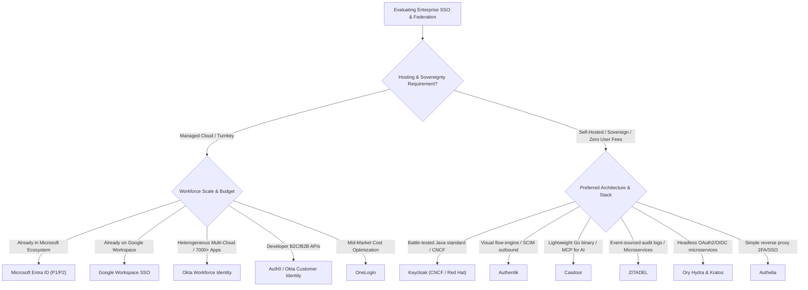

# Awesome Enterprise Single Sign-On (SAML / Okta / OIDC) 🔐

  

 

### 🛡️ Top Enterprise Single Sign-On (SAML/Okta/OIDC) Ecosystem

**Curated List of Commercial SaaS Platforms & Battle-Tested Open-Source Identity Providers**  
*Comprehensive landscape covering SAML 2.0 Federation, OIDC/OAuth 2.0 IdPs, SCIM Provisioning, and Self-Hosted IAM Solutions.*  
**Updated: 2026**

---

## 📖 Introduction & Overview

This repository is an authoritative, SEO-optimized curated landscape tracking notable **commercial SaaS platforms** and **open-source GitHub projects** for **Enterprise Single Sign-On (SSO)**, **SAML 2.0 federation**, **OpenID Connect (OIDC)**, and **Identity and Access Management (IAM)**. 

Organizations face increasing security demands under **Zero Trust architecture**, compliance frameworks (SOC 2, ISO 27001, HIPAA, GDPR), and distributed multi-cloud workforces. Whether implementing commercial enterprise suites like **Okta**, **Microsoft Entra ID**, and **Ping Identity**, or deploying self-hosted, sovereign open-source IdPs like **Keycloak**, **Authentik**, **Casdoor**, and **ZITADEL**, this guide provides technical comparisons, verified starting pricing, free tier limits, and market dynamics.

---

## 📑 Table of Contents
- [📊 Sector Overview & Market Dynamics](#-sector-overview--market-dynamics)
- [☁️ SaaS / Hosted Identity Platforms](#️-saas--hosted-identity-platforms)
- [🚀 Open-Source GitHub Projects](#-open-source-github-projects)
  - [⭐ Featured Category Leaders](#-featured-category-leaders)
  - [🛠️ Additional Mature Open-Source Engines & Libraries](#️-additional-mature-open-source-engines--libraries)
- [🎯 Choosing the Right Architecture: SaaS vs Self-Hosted](#-choosing-the-right-architecture-saas-vs-self-hosted)
- [🤝 How to Contribute](#-how-to-contribute)
- [💖 Support & Sponsorship](#-support--sponsorship)
- [📈 Star History](#-star-history)
- [⚠️ Disclaimer](#️-disclaimer)

---

## 📊 Sector Overview & Market Dynamics

The global **Identity and Access Management (IAM)** sector is valued at approximately **$25 billion to $30 billion in 2026** (projected to surpass $65+ billion by 2033 with an 11–15% CAGR), with dedicated enterprise **Single Sign-On (SSO)** spending representing over **$2.0 billion** of this total.

The market structure is **moderately concentrated among hyperscaler platforms and pure-play identity titans** (Microsoft Entra ID, Google Workspace, Okta, and Ping Identity/ForgeRock) for global workforce identity suites, while remaining **highly dynamic and fragmented across open-source IdPs, developer-first authentication APIs, and sovereign self-hosted infrastructure**.

---

## ☁️ SaaS / Hosted Identity Platforms

*Commercial identity providers sorted by company size (market capitalization / enterprise valuation, descending).*

| Product | Scale & Valuation | Description | Pricing (Starting) | Free Tier / Trial Limits |
|:---|:---|:---|:---|:---|
| **[Microsoft Entra ID](https://www.microsoft.com/en-us/security/business/identity-access/microsoft-entra-id)** | **~$3.9 Trillion** *(Market Cap)* | Cloud IAM with SAML 2.0 and OIDC federation, conditional access policies, and hybrid Active Directory synchronization. | P1: **$6/user/month**; P2: **$9/user/month** | **Free Plan**: Up to 50,000 directory objects (expands to 300,000 objects with verified custom domain) with core SSO/MFA |
| **[Google Workspace SSO](https://workspace.google.com/)** | **~$3.5 Trillion** *(Alphabet Market Cap)* | Native SAML 2.0 IdP and cloud directory federation seamlessly integrated across Google Workspace enterprise apps. | Business Starter: **$7/user/month** (annual); Business Standard: **$14/user/month** | **14-day free trial**: Up to 10 users with full feature access |
| **[Okta](https://www.okta.com/)** | **~$32 Billion** *(Market Cap / ~$3B ARR)* | **The enterprise workforce SSO benchmark.** Features 7,000+ pre-built SAML/OIDC app integrations, adaptive MFA, and lifecycle management. | Workforce Starter: **$6/user/month**; Enterprise: **$17/user/month** | **Free Integrator Plan**: Up to 10 active users, 100 auth/min (non-production/testing); 30-day workforce free trial |
| **[Auth0](https://auth0.com/)** | **~$6.5 Billion** *(Acquired by Okta)* | Developer-first identity platform with turn-key universal login, SAML federation, social logins, and customizable Actions. | Essentials: **$35/month** (up to 500 MAU); Professional: **$240/month** | **Free Plan**: Up to 25,000 MAU, unlimited logins, 3 external social identity providers |
| **[OneLogin](https://www.onelogin.com/)** | **~$5.4 Billion** *(Parent Quest Software EV)* | Mid-market and enterprise SSO and directory synchronization platform featuring automated provisioning and SmartFactor MFA. | Basic: **$3/user/month**; Advanced: **$4/user/month** | **30-day free trial**: Unrestricted feature access across directory and app connectors |
| **[PingFederate / PingOne](https://www.pingidentity.com/)** | **~$2.8 Billion** *(Enterprise Valuation, Thoma Bravo)* | Enterprise federation server and hybrid identity cloud supporting complex federation topologies (SAML 2.0, OIDC, WS-Fed, WS-Trust). | Workforce: **$3/user/month** (minimum 5,000 users) | **30-day free trial**: Up to 1,000 active identities in sandbox environment |

---

## 🚀 Open-Source GitHub Projects

Open-source identity platforms allow organizations to maintain strict data sovereignty, satisfy compliance mandates, and eliminate recurring per-user licensing costs that spiral as workforces scale.

### ⭐ Featured Category Leaders

*Ranked by GitHub Star Count (descending).*

| Project | Star Badge | Language / Stack | License | Core Capabilities & Highlights |
|:---|:---:|:---:|:---:|:---|
| **[Keycloak](https://github.com/keycloak/keycloak)** |  | Java / Quarkus | Apache-2.0 | **The most widely deployed open-source SSO benchmark.** CNCF-incubated project with enterprise-grade multi-tenancy realms, SAML 2.0, OIDC, SCIM 2.0 server capabilities, LDAP/AD federation, and an extensive Java SPI extension system. |
| **[Authelia](https://github.com/authelia/authelia)** |  | Go | Apache-2.0 | **Lightweight authentication and authorization proxy.** Provides two-factor authentication (2FA) and single sign-on companion proxy for Traefik, Nginx, Caddy, and Envoy with minimal overhead. |
| **[Authentik](https://github.com/goauthentik/authentik)** |  | Python / Go | MIT / BSL | **The most flexible sign-in flow and policy engine.** Visual flow orchestrator for complex multi-stage authentications, SAML 2.0, OIDC, LDAP, RADIUS, and native SCIM outbound user provisioning. |
| **[Ory Hydra](https://github.com/ory/hydra)** |  | Go | Apache-2.0 | **Hardened OpenID Connect Certified™ and OAuth 2.0 server.** Headless engine designed to connect directly into your custom user interfaces without imposing pre-packaged frontend constraints. |
| **[ZITADEL](https://github.com/zitadel/zitadel)** |  | Go / TypeScript | AGPL-3.0 | **Cloud-native, event-sourced IAM.** Built-in multi-tenancy (Instances → Organizations → Projects), tamper-proof immutable audit logs, connectRPC/gRPC/REST APIs, and SAML 2.0 / OIDC federation. |
| **[Logto](https://github.com/logto-io/logto)** |  | TypeScript / Node.js | AGPL-3.0 | **Modern developer-first auth and IAM platform.** Auth0/Clerk open-source alternative with enterprise SSO connectors (SAML/OIDC), RBAC, Multi-tenancy, and pre-built UI components. |
| **[Casdoor](https://github.com/casdoor/casdoor)** |  | Go / React | Apache-2.0 | **Lightweight single-binary IdP with broad protocol coverage.** Supports SAML 2.0, OIDC, OAuth 2.0, CAS, LDAP, RADIUS, MCP (Model Context Protocol for AI agents), and built-in user syncers from Okta/Keycloak. |
| **[Ory Kratos](https://github.com/ory/kratos)** |  | Go | Apache-2.0 | **Cloud-native identity and user management system.** Headless user registration, login, profile management, MFA, and recovery implementing Zero Trust security standards. |
| **[Apereo CAS](https://github.com/apereo/cas)** |  | Java / Spring Boot | Apache-2.0 | **Enterprise Central Authentication Service.** Battle-tested academic and enterprise SSO platform supporting Central Authentication Service (CAS) protocol, SAML 1.1/2.0, OAuth 2.0, OpenID Connect, and WS-Federation. |
| **[Dex IdP](https://github.com/dexidp/dex)** |  | Go | Apache-2.0 | **Kubernetes-native OpenID Connect Identity Provider.** Pluggable authentication connector proxying identity federation from SAML 2.0, LDAP, GitHub, GitLab, and Google Workspace to client applications. |

---

### 🛠️ Additional Mature Open-Source Engines & Libraries

*Ranked by GitHub Star Count (descending).*

| Project | Star Badge | Stack | Description |
|:---|:---:|:---:|:---|
| **[Kanidm](https://github.com/kanidm/kanidm)** |  | Rust | Fast, modern identity management and directory server supporting RADIUS, OAuth2/OIDC, and WebAuthn. |
| **[BoxyHQ SAML Jackson](https://github.com/boxyhq/jackson)** |  | TypeScript | SAML SSO & SCIM service that transforms complex SAML/OIDC enterprise federation into standard OAuth 2.0 flows. |
| **[WSO2 Identity Server](https://github.com/wso2/product-is)** |  | Java | Battle-tested, Digital Public Good recognized enterprise IAM with SAML 2.0, OIDC, SCIM 2.0, and FIDO2 deployed across 90+ countries. |
| **[Passport-SAML](https://github.com/node-saml/passport-saml)** |  | Node.js | The standard SAML 2.0 authentication provider strategy for Passport.js in Node.js applications. |
| **[Janssen Project](https://github.com/JanssenProject/jans)** |  | Python / C / Java | Linux Foundation-governed, population-scale IAM engine powering federated OAuth 2.0, OIDC, SAML, and FIDO2. |

---

## 🎯 Choosing the Right Architecture: SaaS vs Self-Hosted

---

## 🤝 How to Contribute

Contributions are welcome! To contribute:

1. 🍴 Fork this repository.
2. 🌿 Create your feature branch (`git checkout -b feature/awesome-sso-entry`).
3. 📝 Add or update factual entries in [README.md](file:///C:/Users/ishan/Documents/Projects/Awesome-Enterprise-Single-Sign-On-SAML-OKTA/README.md) following the existing tabular schema.
4. 🔎 Verify official pricing, free tier terms, and documentation.
5. 📤 Submit a clear Pull Request with context.

---

## 💖 Support & Sponsorship

If you find this curated list helpful for designing, deploying, or architecting your enterprise single sign-on infrastructure:

- ⭐ **Star this repository** to support discovery and development!
- 🍴 **Fork and share** with fellow identity architects and engineers.
- ☕ **Buy me a coffee & support my work**: [GitHub Sponsors Dashboard](https://github.com/sponsors/ishandutta2007)

Your support helps keep these benchmarks and architecture comparisons constantly updated and accurate! 🚀

---

## 📈 Star History

---

## ⚠️ Disclaimer

- This repository is a **community-curated index** for informational and educational purposes. Mention of commercial products or open-source projects does not constitute a formal endorsement.
- Single Sign-On platforms manage root administrative credentials and authentication tokens across connected enterprise infrastructure. Always enforce Multi-Factor Authentication (MFA), least-privilege role-based access control (RBAC), and adhere to relevant compliance mandates (GDPR, SOC 2, HIPAA, ISO 27001).

---

  Built with ❤️ for identity architects, sysadmins, and security professionals worldwide.

